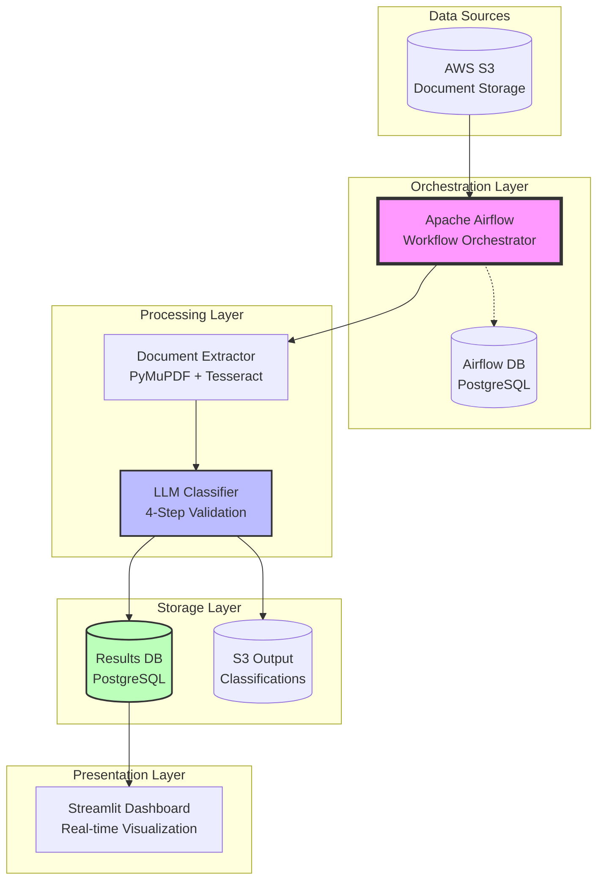
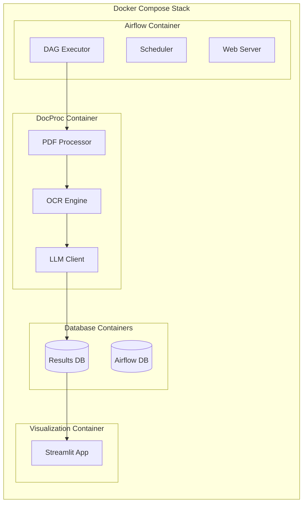
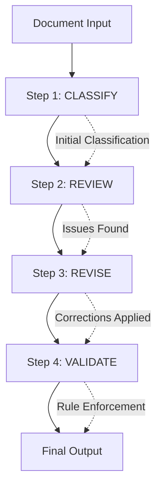

# Technical Documentation - Medical Document Classification Pipeline

## 📊 Architecture Overview

### System Architecture Diagram



### Component Architecture



## 🌟 Key Features

### 1. Intelligent Document Processing

- **Dual Extraction Mode**: Automatic switching between PyMuPDF (digital PDFs) and Tesseract OCR (scanned documents)
- **Smart Detection**: Algorithm determines if OCR is needed based on:
  - Alpha characters per page (< 120 triggers OCR)
  - Word density (< 25 words/page triggers OCR)
  - Image-to-page ratio (≥ 0.5 triggers OCR)

### 2. Advanced Classification System

#### 4-Step Validation Loop



**Step Details:**

1. **CLASSIFY**: Initial classification using document signals and content
2. **REVIEW**: Critical analysis to catch common misclassification patterns
3. **REVISE**: Corrections based on review findings
4. **VALIDATE**: Final rule enforcement and quality checks

### 3. Medical Signal Extraction

The system extracts specialized medical signals:

- **ICD-10 Codes**: International Classification of Diseases codes
- **CPT Codes**: Current Procedural Terminology codes
- **SOAP Structure**: Subjective, Objective, Assessment, Plan sections
- **Prescription Indicators**: DEA numbers, Rx symbols, dosage patterns
- **Medical KV Pairs**: MRN, DOB, DOS, Provider information

### 4. Real-time Monitoring

- Live pipeline status tracking
- Document classification distribution
- Review status analytics
- Confidence scoring visualization

## 🔄 Detailed Workflow

### Main Pipeline Flow

```python
# Simplified DAG structure
start_run() 
    ↓
download_pdfs() 
    ↓
extract_pdfs()  # Docker: docproc:latest
    ↓
classify_llm()  # Docker: docproc:latest
    ↓
upload_artifacts() 
    ↓
load_to_db() 
    ↓
visualize_results()  # Docker: streamlit-viz:latest
```

### Data Flow Details

1. **Initialization Phase**
   - Generate unique run_id
   - Create working directories
   - Register run in database

2. **Data Acquisition**
   - List S3 objects with pagination
   - Filter PDF files
   - Download to local staging

3. **Extraction Process**
   ```python
   for each PDF:
       if is_digital_pdf:
           use PyMuPDF extraction
       else:
           use Tesseract OCR
       extract medical signals
       create LLM payload
   ```

4. **Classification Process**
   ```python
   for each document:
       initial = classify_with_gpt()
       review = review_classification()
       revised = revise_if_needed()
       final = validate_and_enforce_rules()
       save_to_database()
   ```

5. **Results Storage**
   - JSONL format for machine processing
   - CSV format for human review
   - Compressed storage in S3
   - Indexed storage in PostgreSQL

## 📈 Scaling Considerations

### Horizontal Scaling

```yaml
# Current: Single-node processing
# Scalable to: Distributed processing

# Option 1: Celery Executor
AIRFLOW__CORE__EXECUTOR: CeleryExecutor
AIRFLOW__CELERY__BROKER_URL: redis://redis:6379/0

# Option 2: Kubernetes Executor
AIRFLOW__CORE__EXECUTOR: KubernetesExecutor
```

### Batch Processing Optimization

```python
# Current implementation
BATCH_SIZE = 5  # Documents per batch

# Scaling options:
# 1. Increase batch size for throughput
BATCH_SIZE = 20

# 2. Parallel processing
WORKERS = 4  # Concurrent extractors

# 3. Async API calls
async def classify_concurrent(documents):
    tasks = [classify(doc) for doc in documents]
    return await asyncio.gather(*tasks)
```

### Database Scaling

```sql
-- Current: Single PostgreSQL instance
-- Scaling options:

-- 1. Read replicas for dashboard
CREATE PUBLICATION dashboard_pub FOR TABLE classifications;

-- 2. Partitioning for large datasets
CREATE TABLE classifications_2024 PARTITION OF classifications
FOR VALUES FROM ('2024-01-01') TO ('2025-01-01');

-- 3. Additional indexes for performance
CREATE INDEX idx_classifications_run_type 
ON classifications(run_id, predicted_type);
```

## ⚡ Performance Optimizations

### 1. OCR Optimization

```python
# Dynamic DPI adjustment based on page count
def get_optimal_dpi(page_count):
    if page_count > 20:
        return 300  # Lower DPI for large documents
    elif page_count > 10:
        return 350  # Medium DPI
    else:
        return 650  # High DPI for quality
```

### 2. API Rate Limiting

```python
# Exponential backoff implementation
def api_call_with_retry(func, max_retries=3):
    for attempt in range(max_retries):
        try:
            return func()
        except RateLimitError:
            wait_time = 2 ** attempt
            time.sleep(wait_time)
    raise MaxRetriesExceeded()
```

### 3. Caching Strategy

```python
# Document embedding cache
class EmbeddingCache:
    def __init__(self, redis_client):
        self.cache = redis_client
        
    def get_or_compute(self, doc_hash):
        cached = self.cache.get(f"embed:{doc_hash}")
        if cached:
            return json.loads(cached)
        
        embedding = compute_embedding(doc_hash)
        self.cache.setex(
            f"embed:{doc_hash}", 
            3600,  # 1 hour TTL
            json.dumps(embedding)
        )
        return embedding
```

### 4. Memory Management

```python
# Streaming processing for large files
def process_large_pdf(path, chunk_size=10):
    with fitz.open(path) as doc:
        for i in range(0, len(doc), chunk_size):
            chunk = doc[i:min(i+chunk_size, len(doc))]
            yield extract_text(chunk)
```

## 🚀 Future Implementations

### Enhanced Intelligence 

- **Multi-model Ensemble**: Combine GPT-4, Claude, and specialized medical LLMs
- **Active Learning**: Incorporate human feedback for model improvement
- **Custom Fine-tuning**: Train on organization-specific document types
- **Handwriting Recognition**: Enhanced OCR for handwritten prescriptions

## 📚 References

- [Apache Airflow Documentation](https://airflow.apache.org/docs/)
- [OpenAI API Reference](https://platform.openai.com/docs/)
- [Tesseract OCR Documentation](https://tesseract-ocr.github.io/)
- [PyMuPDF Documentation](https://pymupdf.readthedocs.io/)
- [HIPAA Compliance Guide](https://www.hhs.gov/hipaa/)